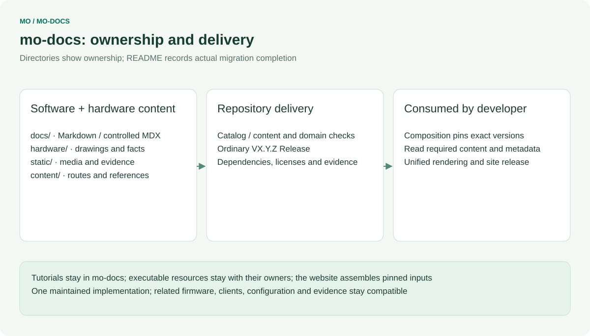
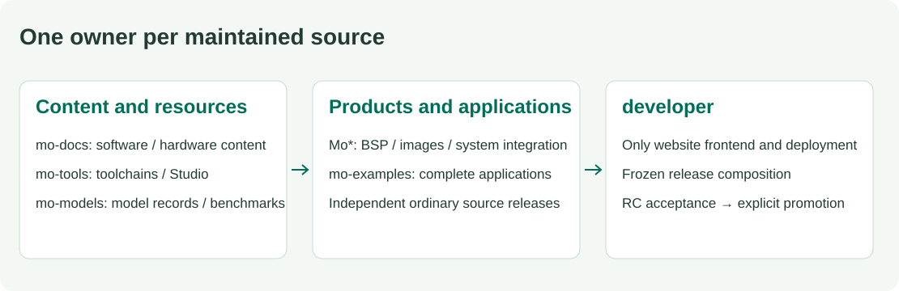
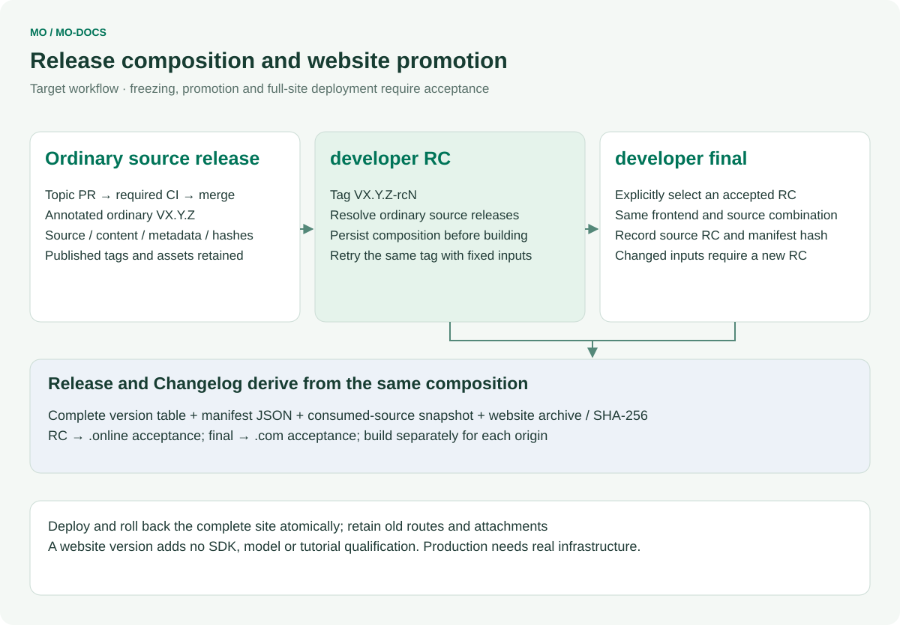

# Mo documentation

[简体中文](README.zh-CN.md)

Software and hardware documentation sources for the Mo series. This repository maintains guides, specifications, media, design files, evidence and authoring metadata. The single Docusaurus website, standard components, search, previews and deployment are maintained in **developer**.

The unified website serves documentation at `/docs/` and preserves `/hardware-docs/` and existing attachment URLs. The test platform is [developer.inhand.online](https://developer.inhand.online/); the production target is [developer.inhand.com](https://developer.inhand.com/), subject to infrastructure and release acceptance. Historical GitHub Pages deployments and release tags remain migration references; new mo-docs releases contain content and do not deploy a website.

## Inside mo-docs

[](architecture/ownership.en.svg)

<table width="100%">
  <thead>
    <tr>
      <th width="284" align="left">Location</th>
      <th width="664" align="left">Maintained content</th>
    </tr>
  </thead>
  <tbody>
    <tr>
      <td align="left"><code>docs/</code></td>
      <td align="left">Software guides, FAQ, board sections, shared Markdown/MDX and category metadata</td>
    </tr>
    <tr>
      <td align="left"><code>static/</code></td>
      <td align="left">Screenshots, licensed media, evidence and compatibility downloads</td>
    </tr>
    <tr>
      <td align="left"><code>hardware/products/</code>, <code>hardware/accessories/</code></td>
      <td align="left">Hardware specifications, interfaces, schematics, mechanical files and accessories</td>
    </tr>
    <tr>
      <td align="left"><code>hardware/training/</code>, <code>hardware/templates/</code></td>
      <td align="left">Maintenance training and author templates; excluded from product navigation</td>
    </tr>
    <tr>
      <td align="left"><code>content/hardware-map.json</code></td>
      <td align="left">Hardware source-to-document route and public asset mapping</td>
    </tr>
    <tr>
      <td align="left"><code>content/asset-aliases.json</code></td>
      <td align="left">Legacy media/download paths generated from one maintained file</td>
    </tr>
    <tr>
      <td align="left"><code>content/hardware-migration.json</code></td>
      <td align="left">Original hardware repository, commit, paths and migration hashes</td>
    </tr>
    <tr>
      <td align="left"><code>validation/</code></td>
      <td align="left">Generated copy of a fixed developer content contract, with commit and hashes</td>
    </tr>
    <tr>
      <td align="left"><code>scripts/</code>, <code>tests/</code>, <code>.github/</code></td>
      <td align="left">Content and resource validation, repository governance and content releases</td>
    </tr>
  </tbody>
</table>

Write normal Markdown. Use registered components for tabs, media, downloads and version tables; component implementation belongs in developer. Shared content and media imports are allowed. Hooks, network requests, arbitrary JavaScript, inline styles and imports from developer's internal `src/` are rejected by the content contract. Teaching code inside fenced code blocks is unaffected. Excel remains a source document or attachment; new structured web data uses JSON.

Hardware material was migrated from mo-hardware. Identical files have one maintained source; the website generates compatibility asset paths. Training and source/license evidence remain in the repository. The hardware map replaces the old software-page redirect stubs during the unified build.

## Mo series repository architecture

[](architecture/repository-map.en.svg)

<table width="100%">
  <thead>
    <tr>
      <th width="171" align="left">Repository</th>
      <th width="398" align="left">Maintained source</th>
      <th width="379" align="left">Delivery responsibility</th>
    </tr>
  </thead>
  <tbody>
    <tr>
      <td align="left"><strong>developer</strong> · GitLab</td>
      <td align="left">Website components, routes, search, integration and contracts</td>
      <td align="left">The complete website, release composition and deployment</td>
    </tr>
    <tr>
      <td align="left"><a href="https://github.com/inhandnet/mo-docs">mo-docs</a></td>
      <td align="left">Software/hardware tutorials, specifications, media, design files and training</td>
      <td align="left">Versioned content and reference assets</td>
    </tr>
    <tr>
      <td align="left"><a href="https://github.com/inhandnet/mo-tools">mo-tools</a></td>
      <td align="left">Toolchain/SDK selection, environment setup, reusable tools and Studio</td>
      <td align="left">Tool metadata and source packages</td>
    </tr>
    <tr>
      <td align="left"><a href="https://github.com/inhandnet/mo-models">mo-models</a></td>
      <td align="left">Model catalog, compilation resources, compatibility and raw benchmarks</td>
      <td align="left">Model references, evidence and artifact status</td>
    </tr>
    <tr>
      <td align="left"><a href="https://github.com/inhandnet/mo-examples">mo-examples</a></td>
      <td align="left">Complete examples with related firmware, clients and configuration</td>
      <td align="left">Example sources and their requirements</td>
    </tr>
    <tr>
      <td align="left"><strong>Mo*</strong> · product repositories</td>
      <td align="left">Each product&#x27;s BSP, drivers, root filesystem, image build and flashing</td>
      <td align="left">Product images and checksummed release metadata</td>
    </tr>
  </tbody>
</table>

`Mo*` covers independently maintained product repositories such as [Mo62A](https://github.com/inhandnet/Mo62A), Mo68A, Mo69A, Mo67A, Mo3588 and Mo3568. The framework does not fix their number. Hardware content and maintainer training move from mo-hardware into mo-docs; mo-hardware remains a historical migration source and is not a separate member of the target website composition.

Each source repository publishes ordinary versions. Developer alone has website RC/final channels. The target composition binds **developer + mo-docs + mo-tools + mo-models + mo-examples + selected Mo\*** to exact commits and consumed-asset hashes. A new source release does not change an already frozen website combination. Tutorial applicability, PCB revisions, image versions and actual validation remain distinct.

## Repository protection

<table width="100%">
  <thead>
    <tr>
      <th width="436" align="left">Operation</th>
      <th width="256" align="left">Write</th>
      <th width="256" align="left">Admin</th>
    </tr>
  </thead>
  <tbody>
    <tr>
      <td align="left">Create, update or delete a topic branch</td>
      <td align="left">Allowed</td>
      <td align="left">Allowed</td>
    </tr>
    <tr>
      <td align="left">Open a PR to <code>master</code></td>
      <td align="left">Allowed</td>
      <td align="left">Allowed</td>
    </tr>
    <tr>
      <td align="left">Merge to <code>master</code></td>
      <td align="left">Not allowed</td>
      <td align="left">After required CI passes</td>
    </tr>
    <tr>
      <td align="left">Merge one&#x27;s own PR</td>
      <td align="left">Not allowed</td>
      <td align="left">Same checks; no second approval required</td>
    </tr>
    <tr>
      <td align="left">Direct push, force-push or delete <code>master</code></td>
      <td align="left">Not allowed</td>
      <td align="left">Blocked by the PR/check ruleset</td>
    </tr>
    <tr>
      <td align="left">Create remote Tags and start releases</td>
      <td align="left">Not allowed</td>
      <td align="left">Allowed; Tag CI validates after push</td>
    </tr>
  </tbody>
</table>

GitHub uses **two rulesets for master and two for all Tags**. Permissions and merge checks are separate because bypass permissions apply to an entire ruleset.

<table width="100%">
  <thead>
    <tr>
      <th width="246" align="left">Ruleset</th>
      <th width="351" align="left">Scope</th>
      <th width="351" align="left">Rules / bypass</th>
    </tr>
  </thead>
  <tbody>
    <tr>
      <td align="left"><code>admin-only-master-updates</code></td>
      <td align="left"><code>refs/heads/master</code></td>
      <td align="left">Restricts creation/update/deletion/force-push; only Admin has bypass</td>
    </tr>
    <tr>
      <td align="left"><code>master-pr-and-required-checks</code></td>
      <td align="left"><code>refs/heads/master</code></td>
      <td align="left">PR, up-to-date required checks, no deletion or force-push; <strong>no bypass</strong>; required approvals: 0</td>
    </tr>
    <tr>
      <td align="left"><code>admin-only-tags</code></td>
      <td align="left">All Tags</td>
      <td align="left">Restricts creation/update/deletion/force-push; only Admin has bypass</td>
    </tr>
    <tr>
      <td align="left"><code>tags-immutable</code></td>
      <td align="left">All Tags</td>
      <td align="left">No updates, deletion or force-push; <strong>no bypass</strong></td>
    </tr>
  </tbody>
</table>

Required checks are `commit-message` and `validate-content`. Topic branches have no additional ruleset restriction. The repository automatically deletes eligible source branches after PR merge. Merge, squash and rebase remain available; when squashing, use the validated PR title and a conforming optional body, including room for GitHub's PR-number suffix.

Local hooks provide early feedback and can be bypassed locally; CI is the merge gate. Admins who can edit repository settings remain trusted operators. The separate immutable-Tag rule has no bypass: **published Tags and Releases must not be rewritten or deleted** in this workflow. Use a new ordinary version for corrections. No local or server-side Tag-creation hook is installed; an invalid Tag remains visible but fails CI before publication.

## English commit messages and Changelog

```text
fix(download): keep the image and checksum on the same release
```

An English Conventional Commit title is sufficient. Add an English body when useful. Types are `feat`, `fix`, `perf`, `docs`, `style`, `refactor`, `test`, `build`, `ci`, `chore`, `revert` and `sync`; the lowercase scope is optional. Keep the title within 72 characters, start the subject with a lowercase letter and omit a final period. Separate a body with a blank line and wrap prose at 72 characters, except URLs and indented code. Do not add credentials, private infrastructure, `Co-Authored-By` or CI-skip markers.

`npm ci` installs this clone's `commit-msg` and `pre-push` hooks, so invalid messages fail at `git commit`, including `git commit -m`. CI checks the PR title and new non-merge commits again. Historical commits before the policy boundary are not rewritten. The policy is in [repository-policy.json](config/repository-policy.json) and [policy.mjs](scripts/lib/policy.mjs).

Release notes use English entries in both editions. Only fixed headings and categories are translated, for example Features / 新功能, Fixes / 修复 and Documentation / 文档. Historical `Message: en` and `Message.en:` summaries remain readable; new commits do not need bilingual blocks. [generate-changelog.mjs](scripts/generate-changelog.mjs) computes the range after the preceding ordinary release. Historical RCs remain traceable but are not a channel for new releases.

### Translation API (planned)

<table width="100%">
  <thead>
    <tr>
      <th width="246" align="left">Platform</th>
      <th width="351" align="left">Translation server</th>
      <th width="351" align="left">Status</th>
    </tr>
  </thead>
  <tbody>
    <tr>
      <td align="left">GitLab</td>
      <td align="left">-</td>
      <td align="left">To be integrated</td>
    </tr>
    <tr>
      <td align="left">GitHub</td>
      <td align="left">-</td>
      <td align="left">To be integrated</td>
    </tr>
  </tbody>
</table>

These are placeholders for future translation of change entries. The current generator runs without a translation API or credentials.

## From a change to a release

[](architecture/release-flow.en.svg)

1. Edit the owning source and open a PR. Content rules, downloadable-resource tests and commit policy must pass.
2. An Admin merges after required CI. Use developer's integrated preview to check affected pages and links; mo-docs has no independent website build.
3. Check remote Tag availability, then create an annotated `VX.Y.Z` Tag on an accepted master commit. New RC Tags are rejected; historical RCs remain unchanged.
4. CI validates and packages a content archive, file hashes, release metadata and bilingual-heading Changelogs, then publishes a complete ordinary GitHub Release through a draft.
5. Developer selects that release in a subsequent website composition, builds and validates the complete site, then owns its release and deployment.

Assets are `mo-docs-VERSION-content.tar.gz`, `content-manifest.json`, `release.json`, `CHANGELOG.en.md`, `CHANGELOG.zh-CN.md`, `release-notes.md` and `SHA256SUMS`. They contain no site build or deploy credentials. Manual dispatch validates/packages without publication. Published Tags and assets are immutable; inspect failed draft publication before retrying and never overwrite a completed release.

## Local authoring

```sh
nvm use
npm ci
npm test
# Install dependencies once in a sibling developer checkout, then:
npm run preview -- --port 8051
```

Set `DEVELOPER_DIR` if the website checkout is elsewhere. Preview runs developer with this mo-docs directory as a local source override and refreshes edited content. Full website builds, browser checks and search indexing run in developer. `npm run docs:diagrams` regenerates the bilingual README diagrams.

See [CONTRIBUTING.md](CONTRIBUTING.md), [ARCHITECTURE.md](ARCHITECTURE.md) and [SECURITY.md](SECURITY.md). Content is CC BY-SA 4.0; third-party notices remain in [static/ASSETS.md](static/ASSETS.md) and beside their source files.

## Migration status and diagrams

Hardware references and maintainer training are consolidated; website implementation lives in developer. Executable tutorial resources now belong to mo-tools, mo-models and mo-examples. `content/resource-map.json` preserves legacy download URLs; `content/resource-migration.json` records original commits, paths, hashes and necessary adjustments. This repository retains prose, images, design attachments and declarative firewall configuration. Developer release freezing and full-site rollout have separate acceptance.

Diagram source is maintained centrally in developer/scripts/render-architecture.mjs. Run `npm run docs:diagrams`, setting DEVELOPER_DIR if necessary, to regenerate this repository's six bilingual SVGs.

## Specification data

Maintain Mo62A specifications in [specifications.json](hardware/products/mo62a/overview/specifications.json). Developer generates hardware documentation, product cards and specification tables from this file. OS and kernel versions come from pinned Mo62A release metadata. Integration expands the `product-specifications` marker; do not maintain a second specification table in prose.
