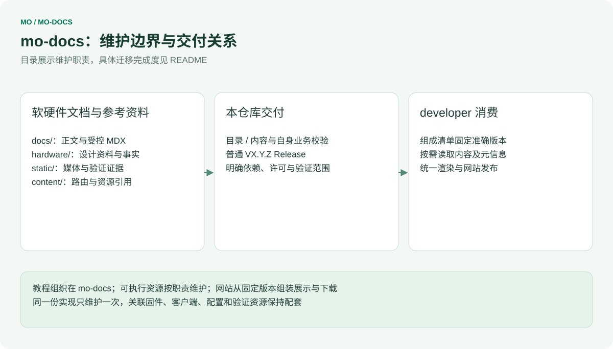

# Mo 文档

[English](README.md)

Mo 系列软硬件文档源仓库，维护教程、规格、媒体、设计资料、验证证据和章节元数据。唯一的 Docusaurus 网站、标准组件、搜索、预览和整站部署统一由 **developer** 维护。

统一网站把软硬件文档及其下载统一放在 `/docs/` 下。测试平台为 [developer.inhand.online](https://developer.inhand.online/)，正式目标为 [developer.inhand.com](https://developer.inhand.com/)，正式上线仍需基础设施和发布验收。网站仍处于正式发布前阶段，不保留旧的 `/hardware-docs/` 路径和旧附件地址；mo-docs Release 只发布内容，不部署网站。

## mo-docs 内部架构

[](architecture/ownership.zh-CN.svg)

<table width="100%">
  <thead>
    <tr>
      <th width="284" align="left">位置</th>
      <th width="664" align="left">维护内容</th>
    </tr>
  </thead>
  <tbody>
    <tr>
      <td align="left"><code>docs/</code></td>
      <td align="left">软件教程、FAQ、板卡章节、共享 Markdown/MDX 与章节元数据</td>
    </tr>
    <tr>
      <td align="left"><code>static/</code></td>
      <td align="left">截图、许可媒体、证据和兼容下载</td>
    </tr>
    <tr>
      <td align="left"><code>hardware/products/</code>、<code>hardware/accessories/</code></td>
      <td align="left">硬件规格、接口、原理图、机械资料和配件</td>
    </tr>
    <tr>
      <td align="left"><code>hardware/training/</code></td>
      <td align="left">维护培训，不进入产品导航</td>
    </tr>
    <tr>
      <td align="left"><code>content/hardware-map.json</code></td>
      <td align="left">硬件源文件与文档路由、公开素材的映射</td>
    </tr>
    <tr>
      <td align="left"><code>validation/</code></td>
      <td align="left">developer 固定版本内容规则的生成副本，记录提交与哈希</td>
    </tr>
    <tr>
      <td align="left"><code>scripts/</code>、<code>tests/</code>、<code>.github/</code></td>
      <td align="left">内容与资源校验、仓库治理和内容发布</td>
    </tr>
  </tbody>
</table>

普通正文写 Markdown；选项卡、媒体、下载和版本表调用标准组件，实现统一放在 developer。允许导入共享正文和媒体文件。内容规则拒绝 Hooks、网络请求、任意 JavaScript、内联样式和 developer 内部 `src/` 导入；代码围栏中的教学代码不受影响。Excel 保留为原始资料或附件，新增结构化网页数据采用 JSON。

每个文件只在 `hardware/` 下维护一份，`content/hardware-map.json` 把硬件页面与附件纳入 `/docs/` 导航；培训、来源和许可证据继续保留。

## Mo 系列仓库协同

[](architecture/repository-map.zh-CN.svg)

<table width="100%">
  <thead>
    <tr>
      <th width="171" align="left">仓库</th>
      <th width="398" align="left">人工维护的源内容</th>
      <th width="379" align="left">交付职责</th>
    </tr>
  </thead>
  <tbody>
    <tr>
      <td align="left"><strong>developer</strong> · GitLab</td>
      <td align="left">网站组件、路由、搜索、接入层与内容接口</td>
      <td align="left">完整网站、发布组成清单与部署</td>
    </tr>
    <tr>
      <td align="left"><a href="https://github.com/inhandnet/mo-docs">mo-docs</a></td>
      <td align="left">软硬件教程、规格、媒体、设计资料与维护培训</td>
      <td align="left">版本化内容与参考附件</td>
    </tr>
    <tr>
      <td align="left"><a href="https://github.com/inhandnet/mo-tools">mo-tools</a></td>
      <td align="left">工具链/SDK 选择、环境准备、通用开发工具与 Studio</td>
      <td align="left">工具元信息和源码包</td>
    </tr>
    <tr>
      <td align="left"><a href="https://github.com/inhandnet/mo-models">mo-models</a></td>
      <td align="left">模型目录、编译资源、兼容关系与原始基准</td>
      <td align="left">模型引用、验证证据与托管状态</td>
    </tr>
    <tr>
      <td align="left"><a href="https://github.com/inhandnet/mo-examples">mo-examples</a></td>
      <td align="left">完整示例及配套固件、客户端和配置</td>
      <td align="left">示例源码及适用条件</td>
    </tr>
    <tr>
      <td align="left"><strong>Mo*</strong> · 各型号仓库</td>
      <td align="left">各自 BSP、驱动、根文件系统、镜像构建与烧录</td>
      <td align="left">系统镜像及带校验值的发布元信息</td>
    </tr>
  </tbody>
</table>

`Mo*` 表示各型号独立的产品仓库，例如 [Mo62A](https://github.com/inhandnet/Mo62A)、Mo68A、Mo69A、Mo67A、Mo3588、Mo3568，框架不固定数量。硬件资料与维护培训由 mo-docs 维护。

各源仓库独立发布普通版本，只有 developer 区分网站 RC 与正式版。目标发布组成绑定 **developer + mo-docs + mo-tools + mo-models + mo-examples + 纳入的 Mo\***，记录准确提交与所消费附件哈希。上游新发版本不会改变已冻结的网站组合。教程适用范围、PCB 修订、镜像版本和实际验证结论分别记录。

## 仓库权限与保护

<table width="100%">
  <thead>
    <tr>
      <th width="436" align="left">操作</th>
      <th width="256" align="left">Write</th>
      <th width="256" align="left">Admin</th>
    </tr>
  </thead>
  <tbody>
    <tr>
      <td align="left">创建、修改、删除临时分支</td>
      <td align="left">允许</td>
      <td align="left">允许</td>
    </tr>
    <tr>
      <td align="left">向 master 提交 PR</td>
      <td align="left">允许</td>
      <td align="left">允许</td>
    </tr>
    <tr>
      <td align="left">合并到 master</td>
      <td align="left">不允许</td>
      <td align="left">必需 CI 通过后允许</td>
    </tr>
    <tr>
      <td align="left">合并自己的 PR</td>
      <td align="left">不允许</td>
      <td align="left">同样通过检查，不强制第二人审批</td>
    </tr>
    <tr>
      <td align="left">直接推送、强推或删除 master</td>
      <td align="left">不允许</td>
      <td align="left">由无绕过的 PR/检查规则阻止</td>
    </tr>
    <tr>
      <td align="left">创建远端 Tag 并启动发布</td>
      <td align="left">不允许</td>
      <td align="left">允许；推送后由 Tag CI 校验</td>
    </tr>
  </tbody>
</table>

GitHub 保留**两条 master 规则和两条全 Tag 规则**。权限与合并检查分开，是因为 bypass 会作用于整条 ruleset。

<table width="100%">
  <thead>
    <tr>
      <th width="246" align="left">Ruleset</th>
      <th width="351" align="left">范围</th>
      <th width="351" align="left">规则与 bypass</th>
    </tr>
  </thead>
  <tbody>
    <tr>
      <td align="left"><code>admin-only-master-updates</code></td>
      <td align="left"><code>refs/heads/master</code></td>
      <td align="left">限制创建、更新、删除和强推，仅 Admin 可 bypass</td>
    </tr>
    <tr>
      <td align="left"><code>master-pr-and-required-checks</code></td>
      <td align="left"><code>refs/heads/master</code></td>
      <td align="left">必须 PR、与主线同步的必需检查、禁止删除与强推；<strong>无 bypass</strong>；审批数为 0</td>
    </tr>
    <tr>
      <td align="left"><code>admin-only-tags</code></td>
      <td align="left">所有 Tag</td>
      <td align="left">限制创建、更新、删除和强推，仅 Admin 可 bypass</td>
    </tr>
    <tr>
      <td align="left"><code>tags-immutable</code></td>
      <td align="left">所有 Tag</td>
      <td align="left">禁止更新、删除和强推；<strong>无 bypass</strong></td>
    </tr>
  </tbody>
</table>

必需检查为 `commit-message`、`validate-content`。临时分支没有额外 ruleset 限制。PR 合并后自动删除符合条件的源分支。保留 merge、squash 和 rebase；选择 squash 时使用已校验的 PR 标题及合规的可选正文，并为 GitHub 自动追加的 PR 编号留出标题长度。

本地钩子提供即时反馈，但可以被本地绕过，CI 才是合并门槛。能够更改仓库设置的管理员仍是受信任操作者；独立的 Tag 不可变规则不设 bypass。因此，**不改写或删除已发布 Tag 和 Release** 是本流程必须遵守的操作约定，修正使用新的普通版本。不安装本地或服务器 Tag 创建钩子；非法 Tag 可以出现在远端，但 CI 会在发布前失败。

## 英文提交与 Changelog

```text
fix(download): keep the image and checksum on the same release
```

一行英文 Conventional Commit 即可，正文按需使用英文。类型为 `feat`、`fix`、`perf`、`docs`、`style`、`refactor`、`test`、`build`、`ci`、`chore`、`revert`、`sync`；小写 scope 可选。标题不超过 72 字符，描述以小写字母开头、不加句号。正文前空一行，普通正文按 72 字符换行，URL 和缩进代码除外。不得包含凭据、内部基础设施信息、`Co-Authored-By` 或跳过 CI 的标记。

`npm ci` 会安装当前克隆的 `commit-msg` 和 `pre-push` 钩子，`git commit`（包括 `git commit -m`）时立即校验。CI 再检查 PR 标题及新增的非 merge 提交，不改写策略边界之前的历史。规则来源为 [repository-policy.json](config/repository-policy.json) 与 [policy.mjs](scripts/lib/policy.mjs)。

两份发布日志的条目都保留英文，只固定翻译标题和分类，例如 Features / 新功能、Fixes / 修复、Documentation / 文档。历史 `Message: en` 与 `Message.en:` 英文摘要继续兼容，新提交不需要双语块。[generate-changelog.mjs](scripts/generate-changelog.mjs) 从上一个普通版本计算提交范围；历史 RC 可用于追溯，不再作为新发布渠道。

### 翻译 API（占位）

<table width="100%">
  <thead>
    <tr>
      <th width="246" align="left">平台</th>
      <th width="351" align="left">翻译服务器</th>
      <th width="351" align="left">状态</th>
    </tr>
  </thead>
  <tbody>
    <tr>
      <td align="left">GitLab</td>
      <td align="left">-</td>
      <td align="left">后续接入</td>
    </tr>
    <tr>
      <td align="left">GitHub</td>
      <td align="left">-</td>
      <td align="left">后续接入</td>
    </tr>
  </tbody>
</table>

此表保留未来翻译变更条目的入口。当前生成器不调用翻译 API，也不需要翻译凭据。

## 从修改到发布

[](architecture/release-flow.zh-CN.svg)

1. 修改事实所属的源文件并提交 PR，内容规则、可下载资源测试和提交规范均须通过。
2. Admin 在必需 CI 通过后合并；通过 developer 的集成预览检查页面与链接，mo-docs 不再独立构建网站。
3. 检查远端 Tag 未占用，在已验收的 master 提交上创建附注 Tag `VX.Y.Z`；新的 RC Tag 会被拒绝，历史 RC 保持不变。
4. CI 校验并打包内容、文件哈希、发布元信息和双语标题 Changelog，经草稿发布完整的普通 GitHub Release。
5. developer 在后续网站组成中选用该版本，统一构建、验证并负责网站发布和部署。

附件包括 `mo-docs-VERSION-content.tar.gz`、`content-manifest.json`、`release.json`、`CHANGELOG.en.md`、`CHANGELOG.zh-CN.md`、`release-notes.md` 和 `SHA256SUMS`，不包含网站构建和部署凭据。手动触发仅校验/打包，不发布。已发布 Tag 和附件不可改写；重试前检查失败草稿的真实状态，不覆盖完整 Release。

## 本地编写

```sh
nvm use
npm ci
npm test
# 先在相邻的 developer 工作区安装一次网站依赖，然后：
npm run preview -- --port 8051
```

网站工作区不在相邻目录时设置 `DEVELOPER_DIR`。预览调用 developer，以当前 mo-docs 作为本地内容来源，修改正文后自动刷新。完整网站构建、浏览器检查和搜索索引均在 developer 中执行。`npm run docs:diagrams` 重新生成中英 README 图示。

参见 [贡献指南](CONTRIBUTING.zh-CN.md)、[技术架构](ARCHITECTURE.md) 和 [安全说明](SECURITY.md)。内容采用 CC BY-SA 4.0；第三方许可保留在 [static/ASSETS.md](static/ASSETS.md) 和相关资源旁。

## 状态与图示维护

网站实现在 developer。教程可执行资源按职责归入 mo-tools、mo-models 和 mo-examples；`content/resource-map.json` 告诉 developer 把它们发布到 `/docs/downloads/` 的位置。正文、图片、设计附件及声明式防火墙配置继续由本仓库维护。developer 的发布冻结与整站上线另行验收。

框架图源统一维护在 developer/scripts/render-architecture.mjs。运行 `npm run docs:diagrams`，或设置 DEVELOPER_DIR 指向已安装的 developer 工作区，生成本仓库六张中英文 SVG。

## 规格数据

Mo62A 规格维护在 [specifications.json](hardware/products/mo62a/overview/specifications.json)，developer 从同一文件生成硬件正文、产品卡片和规格表。镜像系统与内核版本取固定 Mo62A Release 元信息。正文中的 `product-specifications` 标记由接入层替换，不另写一份规格表。
