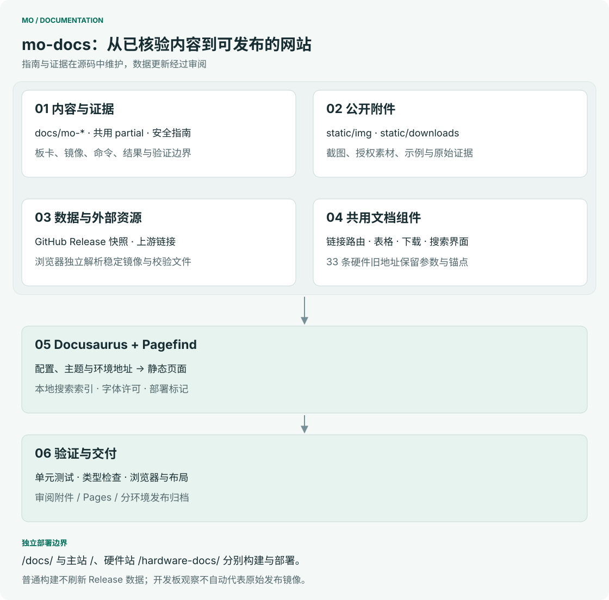
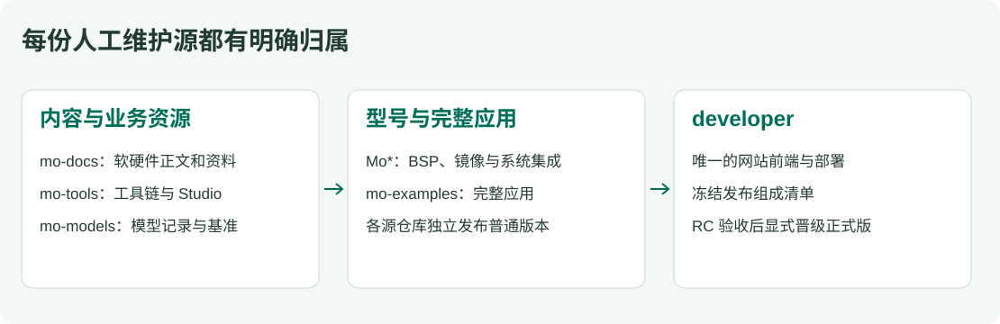
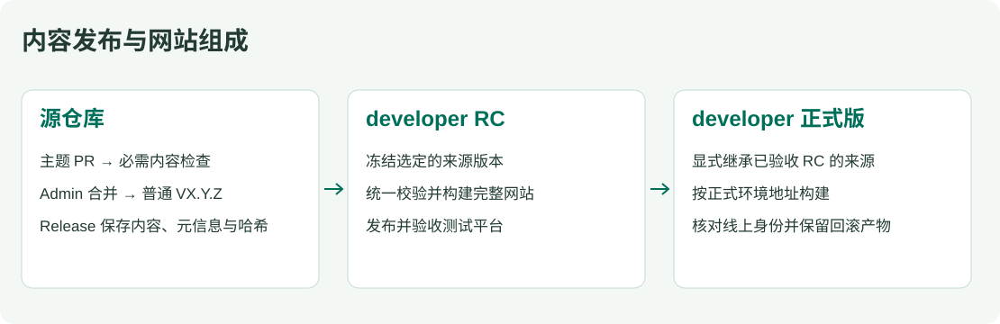

# Mo 文档

[English](README.md)

Mo 系列软硬件文档源仓库，维护教程、规格、媒体、设计资料、验证证据和章节元数据。唯一的 Docusaurus 网站、标准组件、搜索、预览和整站部署统一由 **developer** 维护。

统一网站在 `/docs/` 提供文档，并兼容 `/hardware-docs/` 和已有附件地址。测试平台为 [developer.inhand.online](https://developer.inhand.online/)，正式目标为 [developer.inhand.com](https://developer.inhand.com/)，正式上线仍需基础设施和发布验收。历史 GitHub Pages 与发布 Tag 保留作迁移依据；新的 mo-docs Release 只发布内容，不部署网站。

## mo-docs 内部架构



| 位置 | 维护内容 |
|---|---|
| `docs/` | 软件教程、FAQ、板卡章节、共享 Markdown/MDX 与章节元数据 |
| `static/` | 截图、许可媒体、证据和兼容下载 |
| `hardware/products/`、`hardware/accessories/` | 硬件规格、接口、原理图、机械资料和配件 |
| `hardware/training/`、`hardware/templates/` | 维护培训和编写模板，不进入产品导航 |
| `content/hardware-map.json` | 硬件源文件与文档路由、公开素材的映射 |
| `content/asset-aliases.json` | 从一份维护源生成旧媒体/下载路径 |
| `content/hardware-migration.json` | 原硬件仓库、提交、路径和迁移哈希 |
| `validation/` | developer 固定版本内容规则的生成副本，记录提交与哈希 |
| `scripts/`、`tests/`、`.github/` | 内容与资源校验、仓库治理和内容发布 |

普通正文写 Markdown；选项卡、媒体、下载和版本表调用标准组件，实现统一放在 developer。允许导入共享正文和媒体文件。内容规则拒绝 Hooks、网络请求、任意 JavaScript、内联样式和 developer 内部 `src/` 导入；代码围栏中的教学代码不受影响。Excel 保留为原始资料或附件，新增结构化网页数据采用 JSON。

硬件内容从 mo-hardware 迁入。相同文件只保留一个维护源，网站生成兼容素材路径；培训、来源和许可证据继续保留。统一构建按硬件映射替换原软件目录中的跳转占位页。

## Mo 系列仓库协同



| 仓库 | 唯一维护职责 |
|---|---|
| **developer** | 网站实现、标准组件、来源适配、内容规则、搜索、预览和整站部署 |
| **mo-docs** | 软硬件正文、产品事实、媒体、设计资料和来源/许可 |
| **Mo*** | 各型号 BSP、镜像构建、系统集成和发布元信息 |
| **mo-tools** | 已验证的 TI 工具链/SDK 组合、主机脚本、最小工具链示例和 Studio |
| **mo-models** | 模型目录、编译资源、兼容关系、原始基准和产物状态 |
| **mo-examples** | 完整应用、依赖、配置、验证和发布包 |

各仓独立发版，只有 developer 区分 RC 与正式网站版本。每个 developer Release 冻结自身源码与选定子库普通版本的发布组成清单；正式网站显式继承已验收 RC 的组合。网站组件读取固定数据，不在浏览器中偷偷切换到更新的上游版本。教程适用范围和实际验证状态独立于网站版本。

## 仓库权限与保护

| 操作 | Write | Admin |
|---|---|---|
| 创建、修改、删除临时分支 | 允许 | 允许 |
| 向 master 提交 PR | 允许 | 允许 |
| 合并到 master | 不允许 | 必需 CI 通过后允许 |
| 合并自己的 PR | 不允许 | 同样通过检查，不强制第二人审批 |
| 直接推送、强推或删除 master | 不允许 | 由无绕过的 PR/检查规则阻止 |
| 创建远端 Tag 并启动发布 | 不允许 | 允许；推送后由 Tag CI 校验 |

GitHub 保留**两条 master 规则和一条全 Tag 规则**。权限与合并检查分开，是因为 bypass 会作用于整条 ruleset。

| Ruleset | 范围 | 规则与 bypass |
|---|---|---|
| `admin-only-master-updates` | `refs/heads/master` | 限制创建、更新、删除和强推，仅 Admin 可 bypass |
| `master-pr-and-required-checks` | `refs/heads/master` | 必须 PR、与主线同步的必需检查、禁止删除与强推；**无 bypass**；审批数为 0 |
| `admin-only-tags` | 所有 Tag | 限制创建、更新、删除和强推，仅 Admin 可 bypass |

必需检查为 `commit-message`、`validate-content`。临时分支没有额外 ruleset 限制。PR 合并后自动删除符合条件的源分支。保留 merge、squash 和 rebase；选择 squash 时使用已校验的 PR 标题及合规的可选正文，并为 GitHub 自动追加的 PR 编号留出标题长度。

本地钩子提供即时反馈，但可以被本地绕过，CI 才是合并门槛。能够更改仓库设置的管理员仍是受信任操作者；Tag 规则中的 Admin bypass 也允许行政修改 Tag。因此，**不改写或删除已发布 Tag 和 Release** 是本流程必须遵守的操作约定，修正使用新 RC 或新版本。不安装本地或服务器 Tag 创建钩子；非法 Tag 可以出现在远端，但 CI 会在发布前失败。

## 英文提交与 Changelog

```text
fix(download): keep the image and checksum on the same release
```

一行英文 Conventional Commit 即可，正文按需使用英文。类型为 `feat`、`fix`、`perf`、`docs`、`style`、`refactor`、`test`、`build`、`ci`、`chore`、`revert`、`sync`；小写 scope 可选。标题不超过 72 字符，描述以小写字母开头、不加句号。正文前空一行，普通正文按 72 字符换行，URL 和缩进代码除外。不得包含凭据、内部基础设施信息、`Co-Authored-By` 或跳过 CI 的标记。

`npm ci` 会安装当前克隆的 `commit-msg` 和 `pre-push` 钩子，`git commit`（包括 `git commit -m`）时立即校验。CI 再检查 PR 标题及新增的非 merge 提交，不改写策略边界之前的历史。规则来源为 [repository-policy.json](config/repository-policy.json) 与 [policy.mjs](scripts/lib/policy.mjs)。

两份发布日志的条目都保留英文，只固定翻译标题和分类，例如 Features / 新功能、Fixes / 修复、Documentation / 文档。历史 `Message: en` 与 `Message.en:` 英文摘要继续兼容，新提交不需要双语块。[generate-changelog.mjs](scripts/generate-changelog.mjs) 从上一个**正式版本**计算提交范围，RC 与正式版都包含完整变更，不从上一个 RC 截断。

### 翻译 API（占位）

| 平台 | 翻译服务器 | 状态 |
|---|---|---|
| GitLab | - | 后续接入 |
| GitHub | - | 后续接入 |

此表保留未来翻译变更条目的入口。当前生成器不调用翻译 API，也不需要翻译凭据。

## 从修改到发布



1. 修改事实所属的源文件并提交 PR，内容规则、可下载资源测试和提交规范均须通过。
2. Admin 在必需 CI 通过后合并；通过 developer 的集成预览检查页面与链接，mo-docs 不再独立构建网站。
3. 检查远端 Tag 未占用，在已验收的 master 提交上创建附注 Tag `VX.Y.Z`；新的 RC Tag 会被拒绝，历史 RC 保持不变。
4. CI 校验并打包内容、文件哈希、发布元信息和双语标题 Changelog，经草稿发布完整的普通 GitHub Release。
5. developer 在后续网站组成中选用该版本，统一构建、验证并负责网站发布和部署。

附件包括 `mo-docs-VERSION-content.tar.gz`、`content-manifest.json`、`release.json`、`CHANGELOG.en.md`、`CHANGELOG.zh-CN.md`、`release-notes.md` 和 `SHA256SUMS`，不包含网站构建和部署凭据。手动触发仅校验/打包，不发布。已发布 Tag 和附件不可改写；重试前检查失败草稿的真实状态，不覆盖完整 Release。

## 本地编写

```sh
nvm use
npm ci
npm test
# 先在相邻的 developer 工作区安装一次网站依赖，然后：
npm run preview -- --port 8051
```

网站工作区不在相邻目录时设置 `DEVELOPER_DIR`。预览调用 developer，以当前 mo-docs 作为本地内容来源，修改正文后自动刷新。完整网站构建、浏览器检查和搜索索引均在 developer 中执行。`npm run docs:diagrams` 重新生成中英 README 图示。

参见 [贡献指南](CONTRIBUTING.zh-CN.md)、[技术架构](ARCHITECTURE.md) 和 [安全说明](SECURITY.md)。内容采用 CC BY-SA 4.0；第三方许可保留在 [static/ASSETS.md](static/ASSETS.md) 和相关资源旁。
