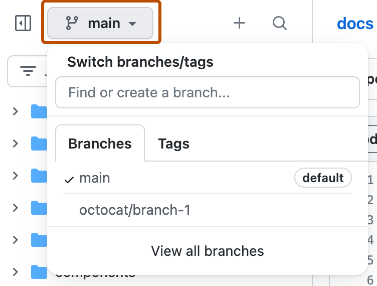
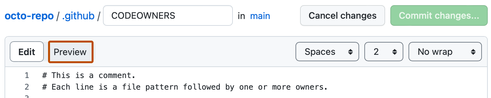
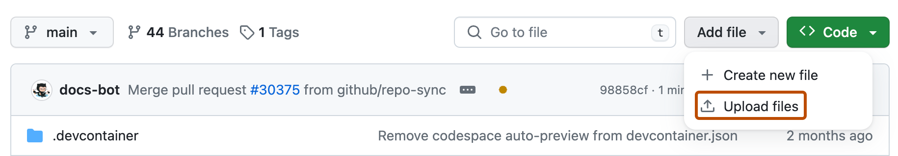

# 在 GitHub 网页维护硬件资料：从修改到发布

[返回培训首页](README.zh-CN.md)

本流程只需要浏览器和 GitHub 账号。以“给机械资料补充一段说明”为例；先在[机械资料练习](examples/mechanical-review/README.zh-CN.md)里走一遍，再用于真实资料。按钮名称可能随 GitHub 更新略有变化，以目标仓库和当前分支为准。

## 1. 准备

- 仓库：[inhandnet/mo-docs](https://github.com/inhandnet/mo-docs)，基线分支 `master`。
- 权限：普通作者申请 Write；没有 Write 时用 **Fork**。不要为了编辑申请 Admin。
- 资料：只提交已确认可公开的正文和附件，并写明版本与来源。仓库公开，工作分支和 Draft PR 也不保密；不要放账号、内网地址、客户信息或未公开设计。

## 2. 找到源文件

在 **Code** 页逐级打开 `hardware` → `products` → `mo62a` → `mechanical` → `mechanical.en-US.md`，或按 `t` 搜索文件名。核对面包屑，避免改到其他产品。

| 内容 | 位置 |
|---|---|
| 产品正文 | `hardware/products/<产品>/<类别>/*.en-US.md` |
| 原理图、STEP 等附件 | `hardware/products/<产品>/<类别>/files/` |
| 产品与接口图片 | `hardware/products/<产品>/images/` |
| 测试记录与原始数据 | `hardware/products/<产品>/validation/<类别>/` |
| 共用配件 | `hardware/accessories/` |
| 网站页面与附件登记 | `content/hardware-map.json` |

正文中的 `/img/...`、`/downloads/...` 是网站路径，GitHub 预览里不显示属正常，需在网站预览中检查。

## 3. 从最新 master 建分支

点击文件列表上方的分支下拉框，选 **master**，输入新分支名（如 `docs/mo62a-mechanical-note`，培训用 `training/<英文标识>-mechanical-review`），点 **Create branch: … from master**。左上角显示自己的分支名后再编辑。

图为 GitHub 官方示意，`main` 等名称只是示例；本仓库基线是 `master`。没有 Write 时先 **Fork**，在自己的 Fork 中建分支。

## 4. 编辑与预览

在自己的分支中打开 `.md` 文件，点铅笔 **Edit this file**。保留文件顶部两条 `---` 之间的标题、描述、排序字段；页面地址由 `content/hardware-map.json` 维护，不要自行加 `slug`。

只改有来源支撑的内容，写清“改了什么、依据是什么、适用于哪个版本、还有什么没验证”。规格与实测分开写；没有依据的写 `not recorded` / `not tested`，不要填 0。改完切到 **Preview** 检查标题、表格、代码块和单位。

## 5. 保存到工作分支

点击 **Commit changes…**，标题用简短英文 Conventional Commit，如 `docs(mechanical): clarify reference model usage`（≤72 字符，不以句号结尾）。选择保存到当前工作分支，不要选 master。

## 6. 上传附件

在同一分支进入对应 `files/` 或 `images/` 目录，点 **Add file → Upload files**。

网页单文件上限 25 MiB；更大的文件请软件维护者用本地 Git 提交。上传前确认是最终版本、能正常打开、来源与许可齐全。附件要在网站上提供下载时，在 PR 里写明源文件路径和希望出现的页面，由维护者登记 `content/hardware-map.json` 的 `assets` 并核对 SHA-256——仓库里有文件不等于网站上有下载。

## 7. 创建 Pull request

点 **Compare & pull request**，确认 base 是 `inhandnet/mo-docs` 的 `master`，compare 是自己的分支。

PR 标题用英文规范，正文可用中文写：改动范围、来源、适用版本、验证结果、未完成项。培训 PR 设为 Draft，首行写 “Training only; do not merge as product documentation.”。

## 8. 检查差异与 CI

在 **Files changed** 中逐文件确认没有误改其他产品、删除来源或限制。PDF/ZIP 无法逐行比较，需下载后用对应软件检查。

必需检查：`commit-message`（PR 标题与提交规范）和 `validate-content`（内容、路径、附件与测试）。两者都绿才算通过；CI 不能代替对硬件事实的人工核对。PR 标题错可直接改标题；已提交的标题错请维护者协助。

## 9. 网站预览、合并与发布

1. 请网站维护者在 developer 集成预览中选用此 PR 的提交，检查目标页、图片、表格、附件下载、桌面与手机显示。
2. 审阅通过、必需 CI 成功后，由 Admin 合并（Squash and merge）。合并不等于测试站已更新。
3. 需要发版时 Admin 在已验收的 master 提交上创建普通附注 Tag `VX.Y.Z`，mo-docs 只发布内容 Release，不部署网站。
4. developer 冻结该内容版本，构建网站 RC，在 [developer.inhand.online](https://developer.inhand.online/) 验收后再晋级正式版。

## 10. 常见问题

| 现象 | 处理 |
|---|---|
| 不能保存或建分支 | 先登录并确认 Write 权限，或改用 Fork |
| CI 报提交标题不合法 | 修改 PR 标题；历史提交请维护者处理 |
| GitHub 中图片不显示 | 站点路径在 GitHub 中不解析，到网站预览确认 |
| 仓库有附件但网站没有 | 检查 `content/hardware-map.json` 是否登记且页面已链接 |
| 测试站还是旧内容 | 合并与网站发布分开，需 developer 发新 RC |
| 页面显示 Coming soon | 证据尚未接入；不能只删提示就宣称已验证 |

## 11. 本地编辑（可选）

批量修改或大附件由软件维护者协助：克隆仓库，从最新 `master` 建分支，执行 `npm ci && npm test`；网站预览用 `npm run preview -- --port 8051` 调用相邻的 developer 工作区。
